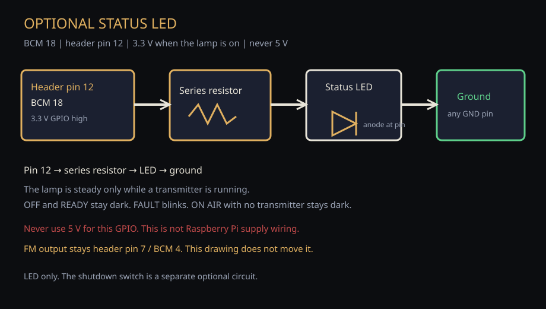
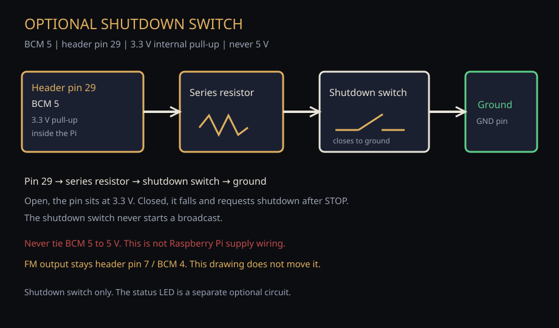
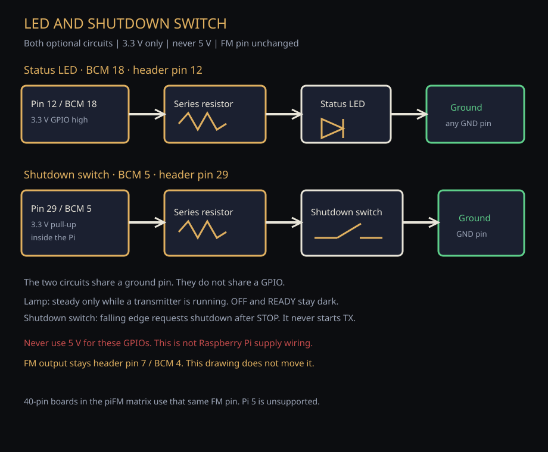

# Hardware

Evidence-based board guidance for piFM. A 40-pin header does **not** imply GPIO
FM works. `pi_fm_rds` must be rebuilt per model/architecture.

## Classifications

| Label | Meaning |
|-------|---------|
| **SUPPORTED / PHYSICALLY VALIDATED** | Complete piFM path proven on that board class |
| **EXPERIMENTAL / NOT PHYSICALLY VALIDATED** | Plausible or upstream-listed; project has not fully validated |
| **UNSUPPORTED** | Known architecture mismatch with the current transmitter path |
| **UNKNOWN** | No project evidence; piFM does not guess |

Do not treat theoretical compatibility as a support claim.

## Board matrix

| Model | SoC / arch | Classification | Physically validated | RF GPIO / header | Network notes | Onboard audio / PWM | Limitations |
|-------|------------|----------------|----------------------|------------------|---------------|---------------------|-------------|
| Raspberry Pi Model A+ Rev 1.1 | BCM2835 / ARMv6 | **SUPPORTED / PHYSICALLY VALIDATED** | Yes (reference station) | BCM **4** / pin **7** | Ethernet (`eth0`) typical | Must be headless; onboard audio disabled | Single-core, ~512 MiB RAM; keep software light |
| Raspberry Pi Zero | BCM2835 / ARMv6 | EXPERIMENTAL | No | BCM 4 / pin 7 (assumed) | USB Ethernet / Wi-Fi HAT varies | Validate PWM exclusivity | Untested by piFM |
| Raspberry Pi Zero W | BCM2835 / ARMv6 | EXPERIMENTAL | No | BCM 4 / pin 7 (assumed) | Onboard Wi-Fi | Validate Wi-Fi + TX coexistence | Untested |
| Raspberry Pi Zero 2 W | BCM2710 / ARMv7/AArch64 | EXPERIMENTAL | No | Rebuild required | Onboard Wi-Fi | Rebuild `pi_fm_rds` on-device | Untested |
| Raspberry Pi 2 | BCM2836 | EXPERIMENTAL | No | Rebuild required | Ethernet | Rebuild on-device | Untested |
| Raspberry Pi 3 | BCM2837 | EXPERIMENTAL | No | Rebuild required | Ethernet / Wi-Fi | Rebuild on-device | Untested |
| Raspberry Pi 4 | BCM2711 | EXPERIMENTAL | No | Rebuild required | Ethernet / Wi-Fi | Clock/governor quirks reported for related tools | Untested |
| Raspberry Pi 5 | RP1 GPIO path | **UNSUPPORTED** | No | No proven `pi_fm_rds` port | — | — | Do not claim support |

Upstream PiFmRds compatibility claims:
https://github.com/ChristopheJacquet/PiFmRds

piFM’s public install path builds the **pinned** upstream revision recorded in
`third_party/pifmrds.pin` (currently
`777f8e52648b88156483d067e24e0b8682abe8c1`). Rebuild `pi_fm_rds` on each
board/architecture; do not float on upstream `master` and do not install from
`pumpkinpi85/PiFmRds` for the product procedure.

Product profile JSON for the validated board:
`hardware/profiles/raspberry-pi-a-plus.json`

## Automatic board detection (honest limits)

With `hardware_profile_mode=auto` (the default), piFM reads board identity
hints from the host (for example model/revision text under `/proc`).

What that means today:

- **Model A+ Rev 1.1** can be matched to the shipped `raspberry-pi-a-plus`
  profile and treated as **SUPPORTED**.
- **Other boards** are not mapped to additional SUPPORTED profiles. Recognition
  does **not** unlock faster paths, larger limits, or a higher support tier.
- Boards listed as EXPERIMENTAL in the matrix above are documentation guidance
  only until physically validated; auto-detect does not promote them.
- If evidence does not match a known SUPPORTED profile, status stays
  **UNKNOWN** (or the operator may set an explicit manual profile, which remains
  experimental until detection and evidence agree).

In short: detection answers “what board is this?” for the A+ support path. It
does not invent support for newer hardware.

## Raspberry Pi Model A+ — wiring beginners need

piFM / PiFmRds reference RF output:

| Function | BCM | Physical header pin |
|----------|-----|---------------------|
| FM RF clock out | **4** | **7** (P1-07) |
| Ground | GND | 6, 9, 14, 20, 25, 30, 34, 39 (any convenient GND) |
| Optional status LED | 18 | 12 |
| Optional shutdown switch | 5 | 29 |

Orientation: with the HDMI/video edge facing you and the 40-pin header at the
top edge of many board drawings, **pin 1** is the end near the SD card corner
on classic boards — always verify against the silkscreen and the diagram below
before soldering.


Minimum conceptual hookup:

1. BCM GPIO 4 (header pin 7) — RF-bearing clock when transmitting
2. GND — return
3. Your RF path — filter / matching / shielded load / antenna **as you design**

piFM does **not** ship a certified filter. Treat raw GPIO output as experimental
and spectrally unclean until measured and filtered. Legal authorization is
operator responsibility — [rf-and-law.md](rf-and-law.md).

## Required environment (validated A+)

Physical timing validation used:

- Boot target: `multi-user.target` (headless; no desktop session)
- Onboard audio: disabled (so PiFmRds keeps exclusive PWM/DMA clock ownership)
- `pi_fm_rds_ppm`: `0.0` product default

Desktop sessions or onboard-audio PWM ownership can produce incorrect playback
speed/pitch. Check without changing the host:

```bash
./scripts/hardware-readiness.py
```

Preview the reversible A+ configuration:

```bash
./scripts/configure-hardware.sh
```

Apply only on a detected Model A+ (backs up boot config and default target):

```bash
sudo ./scripts/configure-hardware.sh --apply
```

Or during install:

```bash
sudo PIFM_CONFIGURE_HARDWARE=1 ./scripts/install.sh
```

## Optional panel controls

The status LED and the shutdown switch are optional. The Broadcast Deck works
without them, and both stay off until you enable them. FM output stays BCM
**4** / header pin **7** on every 40-pin board in the matrix above. These
drawings do not move that pin. Raspberry Pi 5 remains **UNSUPPORTED**.

| Part | BCM | Header pin | Behaviour when enabled |
|------|-----|------------|------------------------|
| Status LED | 18 | 12 | Steady only while a transmitter is actually running. OFF and READY stay dark. FAULT blinks. ON AIR with no running transmitter stays dark. |
| Shutdown switch | 5 | 29 | A falling edge (the switch closes to ground) requests shutdown after STOP. It never starts a broadcast. |

`gpio_enabled` is the master flag and defaults to **false**. `led_enabled`
and `switch_enabled` choose the parts. A config that sets only
`gpio_enabled: true` still enables both, which is the previous behaviour.
`gpio_enabled: false` keeps both parts off even if a part flag is true.

Put a series resistor between BCM 18 and the LED. GPIO high is **3.3 V**.
The shutdown-switch drawing also shows a series resistor between BCM 5 and
the switch; a modest value (for example 1 kΩ) still lets the switch pull the
pin down. piFM enables the BCM 5 internal pull-up to 3.3 V. Do not connect
either GPIO to **5 V**. The shutdown switch is not Raspberry Pi supply wiring.







Stop the appliance service, then from the install:

```bash
python3 scripts/enable-optional-panel.py --led
python3 scripts/enable-optional-panel.py --switch
python3 scripts/enable-optional-panel.py --both
```

`--led` enables only the LED. `--switch` enables only the shutdown switch.
`--both` enables both. Each run sets that selection and writes the default
pins above. The helper does not change `tx_pin`, does not restart the
service, and does not start a transmitter. Add `--dry-run` to preview.
Start the service yourself afterwards, and only when the station should
remain OFF AIR.

To turn the panel off, set `gpio_enabled` to false and start the service
again the same way. The Deck has no GPIO on/off control.

Help → **Optional LED and shutdown switch** opens these drawings from the
install, including when GitHub is unreachable.

## Promoting a board to SUPPORTED

Required evidence:

1. Fresh install of this repository on that board
2. Compatible `pi_fm_rds` built on-device from the pinned upstream
   ChristopheJacquet/PiFmRds SHA in `third_party/pifmrds.pin`
3. Non-RF lifecycle: boot OFF AIR, Deck, library, Play/Pause, Start / Stop on
   mock **or** inhibited/shielded live backend
4. Absolute Stop Broadcast verified
5. Optional founder-authorized RF check — never implied by software-only tests

## Diagrams

Additional diagrams: [diagrams/README.md](diagrams/README.md)

- [Audio pipeline](diagrams/audio-pipeline.svg)
- [Broadcast lifecycle](diagrams/broadcast-lifecycle.svg)
- [Minimal RF path](diagrams/minimal-rf-path.svg)
